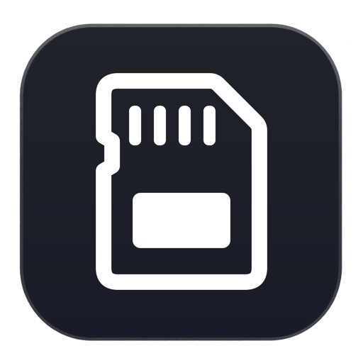
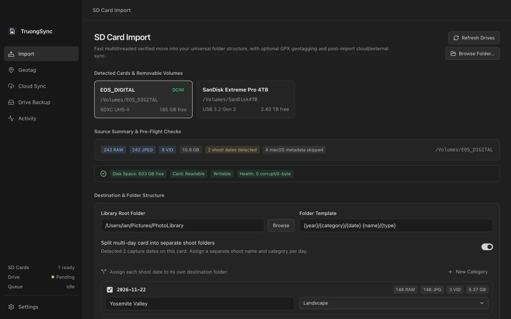
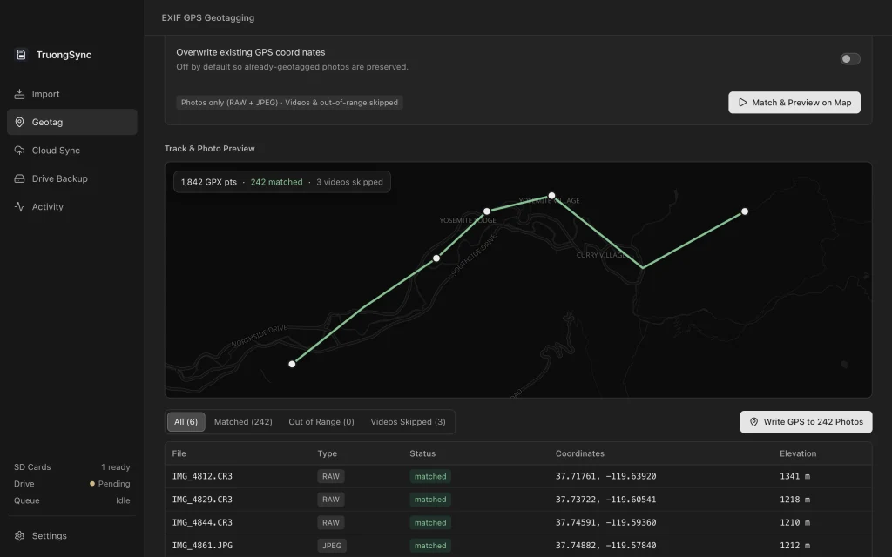
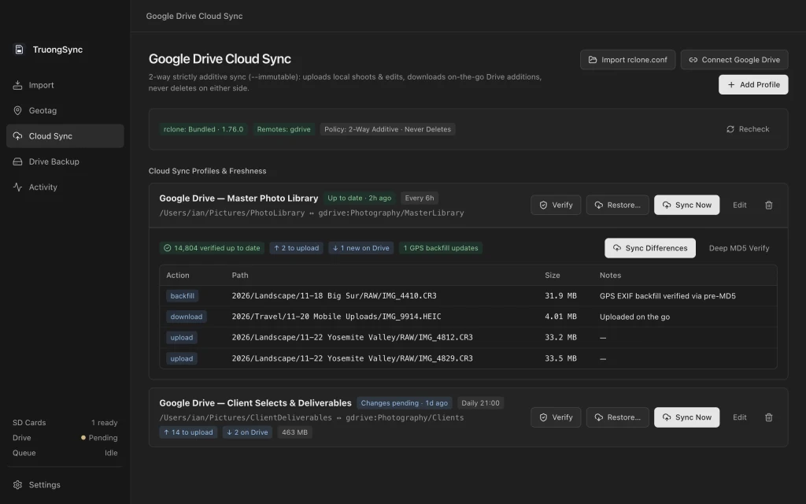
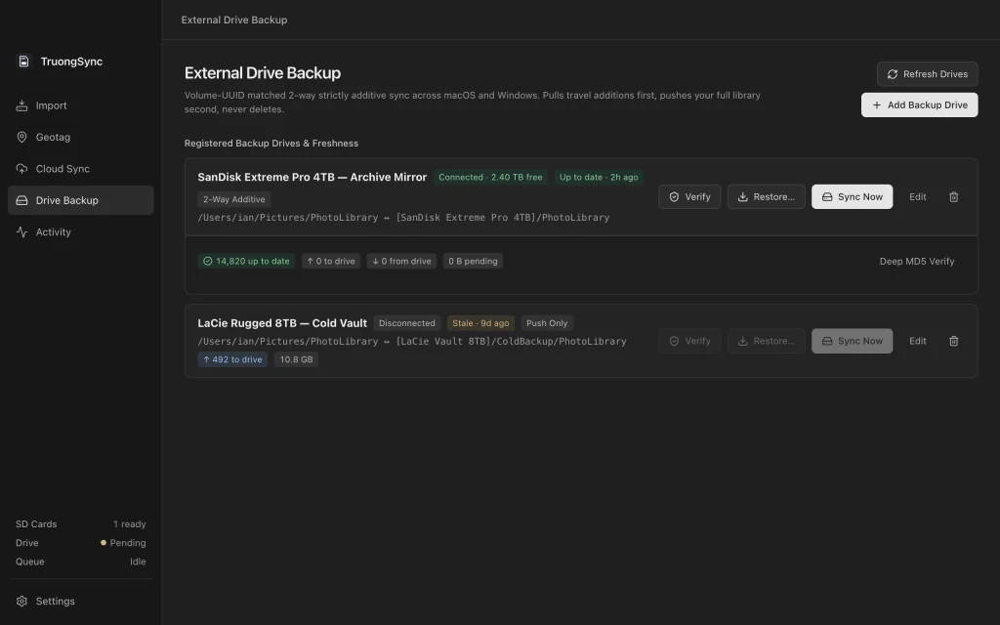
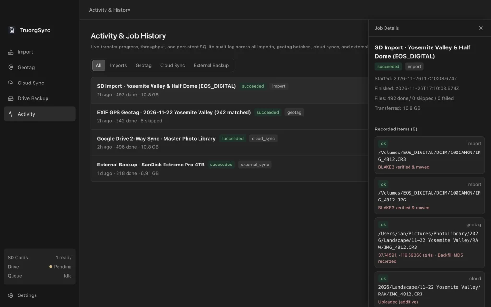
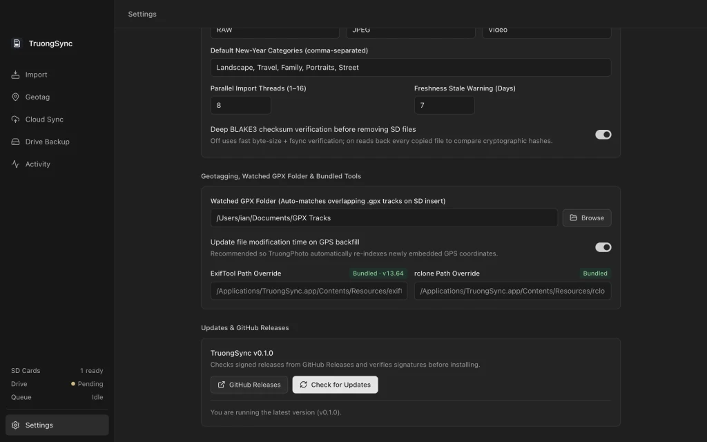

<div align="center">



# TruongSync

A native macOS and Windows photography ingest, EXIF GPS geotagging, and 2-way additive backup studio built in Rust and Tauri 2 — combining zero-setup bundled `rclone` and `ExifTool`, universal folder templates, card health and disk-space preflight checks, offline GPX track matching with interactive map previews, and scheduled Google Drive and external drive backup freshness inside a unified dark studio interface.

[Download for macOS](https://github.com/iant4093/TruongSync/releases/latest/download/TruongSync-macOS.dmg) · [Download for Windows](https://github.com/iant4093/TruongSync/releases/latest/download/TruongSync-Windows-Setup.exe) · [Releases](https://github.com/iant4093/TruongSync/releases) · [Build status](https://github.com/iant4093/TruongSync/actions) · [Report an issue](https://github.com/iant4093/TruongSync/issues)

[](https://github.com/iant4093/TruongSync/releases/latest/download/TruongSync-macOS.dmg)
[](https://github.com/iant4093/TruongSync/releases/latest/download/TruongSync-Windows-Setup.exe)


_%7C_Windows_x64-555555)
[](https://github.com/iant4093/TruongSync/actions/workflows/ci.yml)

</div>

---

TruongSync automates the entire post-shoot photography pipeline on both macOS and Windows with zero external CLI installations required. Plug in a camera SD card (`DCIM/`) and TruongSync automatically detects the card, runs disk-space and card-health preflight checks, groups captures by shoot date, routes `RAW`, `JPEG`, and `Video` files into your custom folder template with atomic copy-verify-move safety, matches overlapping `.gpx` tracks to embed EXIF GPS coordinates across RAW and JPEG files, and syncs additively to Google Drive and external backup drives on your schedule. Releases target Apple Silicon Macs and 64-bit Windows.

Every backup operation is **strictly additive (never destructive)** by default: new files uploaded to Google Drive on the go are downloaded back to your local library, new local shoots are uploaded to Drive and mirrored to your external drives, and deliberately deleted local files are recorded as tombstones in SQLite so they are never silently resurrected unless you explicitly trigger **Restore**. When you backfill GPS coordinates onto previously synced photos, TruongSync tracks pre- and post-write MD5 hashes so only those intentionally geotagged files are safely replaced on Google Drive and external drives — without ever overwriting unrelated edits.

## Screenshots

Screenshots capture the live dark studio UI across all six workflow views, using the same Apple-grade neutral dark interface as TruongPhoto.

<table>
  <tr>
    <td width="50%" valign="top">
      
      <p align="center"><sub><b>SD Card Import &amp; Preflight</b> · auto-detected DCIM cards, date grouping, universal folder templates and preflight checks</sub></p>
    </td>
    <td width="50%" valign="top">
      
      <p align="center"><sub><b>EXIF GPS Geotagging</b> · watched GPX auto-matching, interactive map preview, clock offset and batch ExifTool writes</sub></p>
    </td>
  </tr>
  <tr>
    <td width="50%" valign="top">
      
      <p align="center"><sub><b>Google Drive 2-Way Sync</b> · freshness indicators, one-click OAuth, additive push/pull, Verify and Restore</sub></p>
    </td>
    <td width="50%" valign="top">
      
      <p align="center"><sub><b>External Drive Backup</b> · Volume UUID matching, freshness alerts, 2-way additive sync and verify</sub></p>
    </td>
  </tr>
  <tr>
    <td width="50%" valign="top">
      
      <p align="center"><sub><b>Activity &amp; Job Inspector</b> · persistent SQLite job history with per-file audit logs and transfer metrics</sub></p>
    </td>
    <td width="50%" valign="top">
      
      <p align="center"><sub><b>Settings, Bundled Tools &amp; Updates</b> · OS-native SD auto-open, power/bandwidth guards, bundled tools and signed updates</sub></p>
    </td>
  </tr>
</table>

## Features

**SD Card Ingest, Universal Folder Templates & Preflight Safety**

- Automatic removable camera card detection (`DCIM/`) on macOS (`/Volumes`) and Windows (drive letters + WMI/Win32 volume info), with optional one-click **OS-Native Auto-Open** (`launchd` LaunchAgent on macOS, per-user HKCU AutoPlay handler on Windows — zero admin required)
- Universal folder template engine supporting `{year}`, `{category}`, `{date}`, `{name}`, `{type}`, and custom date formats (e.g. `M-dd` or `yyyy-MM-dd`), plus saved reusable **Import Presets** and automatic new-year category folder scaffolding
- Card-health and disk-space **Preflight Checks** before a single byte moves: verifies source readability/writability, flags 0-byte or unreadable files, skips macOS AppleDouble (`._*`) junk, and enforces a safety headroom buffer on the destination volume
- Multi-threaded atomic copy-to-temp-and-rename pipeline (`rayon`) with fsync durability, optional deep `BLAKE3` cryptographic checksum verification before removing source SD files in Move mode, per-file collision protection, and optional safe auto-eject

**Offline GPX Track Matching & Batch EXIF Geotagging**

- Watched GPX folder auto-matching that automatically finds `.gpx` tracks overlapping your shoot's capture timestamps on SD insert or manual folder selection
- Pure-Rust GPX XML parser (`quick-xml`) with linear track-point interpolation, configurable camera clock offset (`±` seconds) and maximum interpolation gap, and an interactive `MapLibre GL JS` route & geotagged-photo preview
- Fast batch EXIF GPS writing via bundled **ExifTool** (`-overwrite_original` with safe pre/post MD5 tracking and optional mtime bump so TruongPhoto immediately re-indexes newly geotagged photos)
- Safe **GPS Backfill Sync**: every locally geotagged file records its `(pre_md5, post_md5)` pair in SQLite so subsequent Google Drive or external drive syncs verify the remote copy matches `pre_md5` before safely replacing it with the geotagged version

**Google Drive 2-Way Additive Sync & External Drive Backup**

- **One-click Google Drive OAuth** powered by bundled `rclone` (plus optional `rclone.conf` import and custom Google OAuth Client ID/Secret support)
- **Strictly Additive 2-Way Sync (Never Delete)**: downloads files added remotely on the go, uploads new local shoots, skips deleted-local tombstones during normal sync, and provides an explicit **Restore** mode to pull missing or tombstoned files back from Drive or external drives
- **Backup Freshness & On-Demand Verify**: every Google Drive and External Drive profile tracks last sync/verify timestamps, pending upload/download counts, stale-backup warnings, and one-click **Verify** (with optional deep MD5 comparison) right on the same screen
- **External Drive Volume UUID Matching**: binds backup profiles to each drive's stable Volume UUID (not volatile drive letters or mount names), warns on drive-connect, supports 2-way additive sync, and writes an optional backup timestamp marker file

**Scheduling, Power Guards & Zero-Setup Bundling**

- Flexible per-profile background scheduler (`Manual`, `On Startup`, `Every N Hours`, `Daily at HH:MM`, or `On Drive Connect`) running quietly in the menu bar / system tray with launch-at-login support
- Optional **Google Drive bandwidth cap** (MB/s), automatic **OS sleep prevention** (`caffeinate` / IOKit assertion on macOS, `SetThreadExecutionState` on Windows) during active transfers, and **Pause scheduled syncs on battery**
- Self-contained desktop installers bundling `rclone` and pure-Perl `ExifTool` (macOS) / standalone `exiftool.exe` + `exiftool_files` (Windows) — zero Homebrew, Winget, or manual PATH setup required
- Persistent SQLite WAL job history (`rusqlite`) with slide-over per-file audit logs, live progress streaming, cooperative cancellation, and signed GitHub Releases auto-updates

## Install

Download the latest installers from [GitHub Releases](https://github.com/iant4093/TruongSync/releases/latest). Installed apps update themselves from there.

**macOS** (Apple Silicon, macOS 14.0 or later)

1. Download [TruongSync-macOS.dmg](https://github.com/iant4093/TruongSync/releases/latest/download/TruongSync-macOS.dmg) and drag TruongSync into Applications.
2. Open TruongSync. macOS will say it can't verify the developer, because release builds are ad-hoc signed rather than notarized. Click **Done**, then go to **System Settings › Privacy & Security**, scroll down to the message about TruongSync and click **Open Anyway**, then confirm with your password. You only need to do this once.

**Windows** (x64, Windows 10 1809 or later / Windows 11)

1. Download [TruongSync-Windows-Setup.exe](https://github.com/iant4093/TruongSync/releases/latest/download/TruongSync-Windows-Setup.exe) and run it.
2. If SmartScreen appears, choose **More info › Run anyway**. The installer is not code-signed.

`rclone` and `ExifTool` are bundled directly inside both installers and work immediately with zero external dependencies. Installed copies can check for updates from **Settings › Updates & GitHub Releases**, inspect release notes, and install signed updates in place.

## Tech stack

| Area | Technologies |
|---|---|
| App shell | Tauri 2 (Rust), WKWebView on macOS, WebView2 on Windows, native Menu Bar / System Tray |
| Interface | React 19, TypeScript, Vite, Zustand, `lucide-react`, `MapLibre GL JS`, custom Apple neutral dark theme |
| Storage & Integrity | SQLite (`rusqlite` bundled WAL), `BLAKE3` deep transfer verification, `MD5` GPS backfill verification |
| Ingest & Geotagging | `rayon` parallel transfer engine, `nom-exif`, `quick-xml` GPX parser, bundled `ExifTool` |
| Cloud & External Sync | Bundled `rclone` (2-way additive sync, OAuth, bandwidth caps), Volume UUID detection (`plist` / Win32) |
| OS Integration | macOS `launchd` LaunchAgent & IOKit power/sleep assertions, Windows HKCU AutoPlay & `SetThreadExecutionState` |
| Delivery | GitHub Actions, macOS `.dmg`, Windows NSIS installer, signed auto-updates (`latest.json`), SHA-256 checksums |

## Build locally

Requires **Node 22.12+**, **Rust 1.90 or newer** (CI builds with 1.94.0) and the [Tauri prerequisites](https://v2.tauri.app/start/prerequisites/) for your platform.

```bash
npm install

# Download and verify bundled rclone + ExifTool sidecars for your OS/arch
npm run fetch:sidecars

# Desktop app with hot reload
npm run app:dev

# Release build: stages sidecars, builds installers, signs updates, writes latest.json
npm run app:build
```

`app:build` signs updates with `~/.tauri/truongsync.key` or `$TAURI_SIGNING_PRIVATE_KEY`. Generate a key once with `npx tauri signer generate -w ~/.tauri/truongsync.key`. Without it, use `npm run fetch:sidecars && npx tauri build --config '{"bundle":{"createUpdaterArtifacts":false}}'` for an unsigned local build.

## Tests

```bash
# Frontend unit and component tests (Vitest)
npm test

# TypeScript check and production frontend build
npm run build

# Rust format, strict Clippy lints, and workspace unit/integration tests
cargo fmt --all -- --check
cargo clippy --workspace --all-targets --locked -- -D warnings
cargo test --workspace --locked
```

## CI and releases

Pull requests and pushes to `main` run:

1. Vitest unit tests, a TypeScript check and a production frontend build.
2. macOS and Windows builds: `rustfmt` check, strict `clippy` lints across all workspace crates, Rust unit and integration tests, sidecar staging (`scripts/fetch-sidecars.mjs`), and Tauri installer packaging.

Pushes to `main` produce test installers in the Actions artifacts. After desktop acceptance testing, manually run **CI** on `main` with **publish** enabled to publish a GitHub Release `v<major>.<minor>.<run number>` containing `TruongSync-macOS.dmg`, `TruongSync-Windows-Setup.exe`, the macOS updater archive (`TruongSync-macOS.app.tar.gz`), `latest.json` (with the update signatures) and `SHA256SUMS`. The release notes are generated from the commit messages since the previous release, and the same list appears in the app's update prompt. Installed apps pick up the new version through `latest.json`. Pull requests and ordinary pushes never publish.

The updater signing key is stored as the `TAURI_SIGNING_PRIVATE_KEY` repository secret. Builds without it (such as fork pull requests) still produce installers, just without update signatures. GitHub Actions are pinned to commit SHAs, and Dependabot checks them weekly.

## Repository layout

```text
.
├── src/                    React app (Dark studio desktop UI)
│   ├── components/         Shared components: Sidebar, Dropdown, QuickSetupCard,
│   │                       GpxMapPreview, Feedback, WindowControls, ui primitives
│   │   └── views/          Workflow views: ImportView, GeotagView, CloudSyncView,
│   │                       DriveBackupView, ActivityView, SettingsView
│   ├── store/              Zustand stores (useSyncStore.ts, feedback.ts)
│   ├── lib/ types/         Typed Tauri IPC bridge (tauri.ts), escape stack, DTO types (types/api.ts)
│   └── styles/             Apple neutral dark theme (theme.css)
├── crates/                 Rust workspace crates
│   ├── truongsync-db/      SQLite WAL database, schema migrations, profiles, tombstones,
│   │                       GPS backfill tracking, and persistent job history
│   ├── truongsync-ingest/  SD card & volume detection, universal folder templates,
│   │                       preflight health/space checks, parallel atomic transfer engine
│   ├── truongsync-geo/     GPX XML parser, timestamp interpolation, watched-folder matcher,
│   │                       and bundled ExifTool batch writer
│   └── truongsync-sync/    Bundled rclone Google Drive 2-way additive sync, OAuth helper,
│                           external Volume-UUID backup engine, verify & restore
├── src-tauri/              Tauri 2 desktop host (truongsync-desktop): IPC commands,
│                           OS-native SD auto-launch, background scheduler, sleep/battery
│                           guards, Menu Bar / System Tray, updater & bundle config
├── tests/                  Vitest unit and component tests
├── scripts/                Sidecar bundler (fetch-sidecars.mjs) & release script (release.mjs)
├── docs/                   Screenshots and architecture documentation
├── public/                 App icon (app-icon.png)
├── .github/                CI/release workflow and Dependabot
├── index.html              Main desktop window entry
└── README.md
```

TruongSync is licensed under the MIT License. Bundled sidecars (`rclone` under MIT License and `ExifTool` under Artistic License 1.0 / GPL-1.0+) are redistributed as unmodified upstream packages staged automatically during build.
